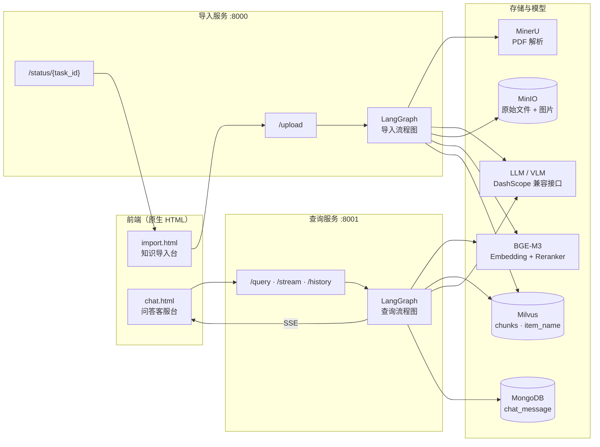
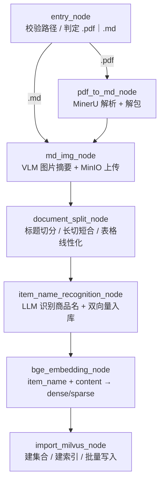
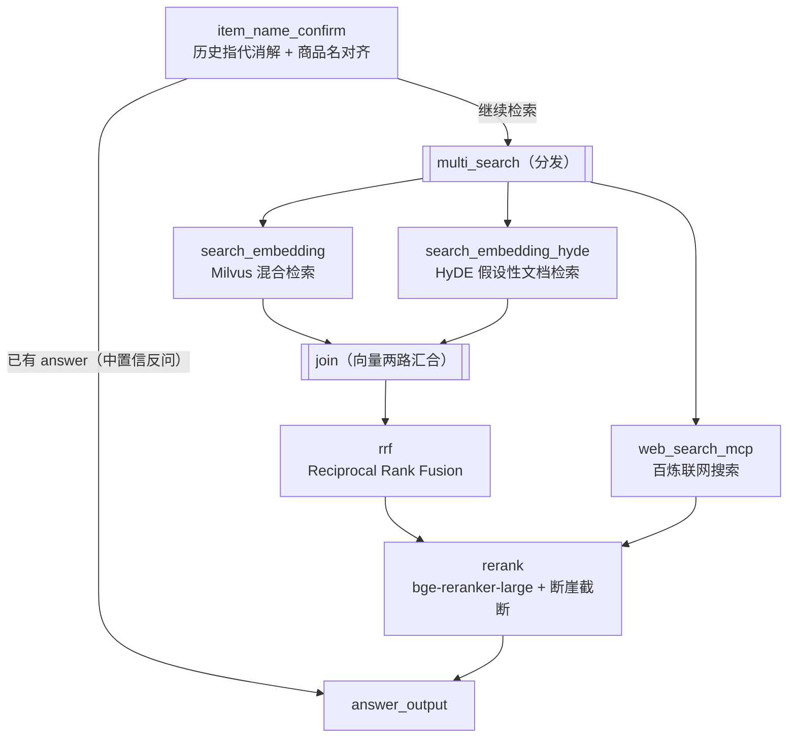

# 企业级设备手册智能问答平台

> 把厚重的 PDF / Markdown 设备手册变成可检索、可对话、能配图回答的知识库。
> 基于 **LangGraph + Milvus + BGE-M3 + MinerU + 大模型** 的端到端 RAG 工程实现。

<p align="left">
  
  
  
  
  
  
  
  
  
</p>

> **有评测**：50 题分层评测集 + A1~A5 检索消融 + 答案层模型 A/B，见 [评测](#评测) 与 [`eval/`](eval/README.md)。
> 结论不是"全都好用"：实测 **HyDE 在这个业务上是负收益**（三轮 run 都没赢过纯混合检索，建议下线）；
> **qwen3.8-flash 的思考模式必须关**（HyDE p95 从 6.6 s 涨到 47.6 s）。两条都写进了[已知限制](#已知限制与规划)。

---

## 目录

- [项目简介](#项目简介)
- [核心能力](#核心能力)
- [系统架构](#系统架构)
- [导入流水线](#导入流水线)
- [查询流水线](#查询流水线)
- [技术栈](#技术栈)
- [目录结构](#目录结构)
- [快速开始](#快速开始)
- [接口文档](#接口文档)
- [数据模型](#数据模型)
- [关键配置项](#关键配置项)
- [评测](#评测)
- [已知限制与规划](#已知限制与规划)
- [更新记录](#更新记录)

---

## 项目简介

企业内部沉淀着大量设备手册：万用表、示波器、网关、交换机、工业控制器…… 它们通常是几十上百页的 PDF，图文混排、表格密集，关键词搜索找不到答案，翻页定位极其低效。

本项目把「手册」加工成「可对话的知识」：

1. **入库**：PDF 经 MinerU 解析为结构化 Markdown，图片被 VLM 语义化并托管到对象存储；
2. **切分**：按标题层级切分 + 长切短合 + 表格线性化，切片自带 `文件 / 父标题 / 标题 / 商品名` 四级上下文；
3. **检索**：BGE-M3 稠密 + 稀疏双向量混合检索，RRF 融合后 bge-reranker 精排，再按分数断崖自适应截断
   （另实现了 HyDE 与联网 MCP 两路召回，但实测 HyDE 在本业务为负收益，详见[评测](#评测)）；
4. **回答**：大模型基于命中切片生成答案，支持 SSE 流式输出，并可直接回显手册原图（接线图、示意图、结构图）。

同时提供两条独立的 FastAPI 服务与两套零依赖原生页面：**知识导入台**（上传 + 节点级进度）与**问答客服台**（流式对话 + 历史会话）。

## 核心能力

| 能力 | 说明 |
| --- | --- |
| 手册结构化解析 | MinerU 4.x `parse -f zip --tier standard --ocr-mode auto`，保留 Markdown + images + 中间 JSON，表格与公式不丢 |
| 图片语义化 | 按「最近章节标题 + 上下 200 字正文」构造上下文，调用视觉大模型生成图片摘要，替换为 MinIO 公网链接，答案可直接带图 |
| 结构化切分 | 识别代码围栏内的 `#` 防止误切；标题层级维护 `hierarchy[]` 还原父标题；超长切片二次切分、过短切片合并；子切片标题带 `（n/N）` 序号，不用正文首句充当标题 |
| 表格降维 | HTML / Markdown 表格统一线性化为「列名: 值」文本，避免表格被切断后语义丢失 |
| 商品主体识别 | LLM 从手册前若干切片抽取「品牌 + 型号 + 品类」写入 `item_name`，查询时作为标量过滤条件，避免跨设备串答案 |
| 商品名对齐 | 用户口述的「万用表」在 `item_name` 集合做混合检索对齐到库中规范名；分数差过滤 + 高置信锁定 / 歧义反问 / 历史回填 |
| 混合检索 | 同一份文本同时产出 dense（COSINE）与 sparse（IP）向量，Milvus `WeightedRanker(0.5, 0.5)` 融合 |
| 多路召回 | 向量检索 ∥ HyDE 检索 ∥ 联网 MCP 搜索 三路并行；两路向量经 `join` 汇合走 RRF 去重，联网结果直连 `rerank` |
| 动态精排 | bge-reranker-large 打分，按分数断崖（gap ≥ 0.15）自适应截断 top-k（3~10），而非固定取前 N |
| 流式问答 | SSE 三类事件：`progress`（节点进度）/ `delta`（增量 token）/ `final`（完整答案） |
| 会话记忆 | MongoDB `chat_message` 持久化，查询前做指代消解（"它怎么测电阻" → "RS-12 数字万用表怎么测电阻"） |
| 任务可观测 | 每个导入任务 8 位 task_id，逐节点记录 running / done / 耗时，前端 1.5s 轮询渲染时间线 |

## 系统架构



## 导入流水线

`knowledge/processor/import_process/main_graph.py` —— 7 节点串行图，入口按后缀分流。



| # | 节点 | 职责 | 关键实现 |
| --- | --- | --- | --- |
| 1 | `entry_node` | 路径校验、按扩展名路由、提取 `file_title` | `ValidationError` 兜底，非 pdf/md 直接中断 |
| 2 | `pdf_to_md_node` | 调 `mineru-kit parse` 生成 zip，解包出 `markdown.md + images/` | `--tier standard`（小模型 + VLM）、`--ocr-mode auto`、行缓冲实时打印 |
| 3 | `md_img_node` | 扫描图片 → 定位章节上下文 → VLM 生成摘要 → 上传 MinIO → 回写链接 | 三段式：`ImageScanner` / `VLMSummarizer`（20 rpm 限流）/ `ImageUploader` |
| 4 | `document_split_node` | 标题切 initial section → 超长二次切 → 过短合并 → 组装 chunk | `hierarchy[7]` 还原父标题、代码围栏感知、`<table>` 线性化、子切片标题追加 `（n/N）` 序号 |
| 5 | `item_name_recognition_node` | 取前 3 个切片（≤2500 字）让 LLM 输出商品名，写入 item_name 集合 | 结构化 Prompt + `UNKNOWN` 兜底 |
| 6 | `bge_embedding_node` | 以 `item_name + "\n" + content` 为嵌入文本，批量生成双向量 | batch=8，CSR → `{token_id: weight}` |
| 7 | `import_milvus_node` | 建集合（dynamic field）、建双索引、批量 insert 并回填 `chunk_id` | 门面 + 建造者模式：SchemaBuilder / IndexBuilder / Inserter |

导入阶段同时完成**文件双写**：本地 `knowledge/temp_data/{YYYYMMDD}/{task_id}/` 与 MinIO `origin_files/{YYYYMMDD}/{filename}`，便于溯源与重放。

## 查询流水线

`knowledge/processor/query_process/main_graph.py` —— 先确认主体，再并行三路召回，融合精排后生成答案。



| # | 节点 | 职责 | 关键参数 |
| --- | --- | --- | --- |
| 1 | `item_name_confirm` | 读最近会话 → LLM 抽取 `item_names` 与 `rewritten_query` → 在 `item_name` 集合混合检索对齐 → 分数差过滤 → 置信度决策（锁定 / 反问 / 兜底）→ 历史回填 | 高置信 0.7 / 中置信 0.6 / 最多 5 个候选 / 差值 0.15 |
| 2 | `search_embedding` | `item_names` 作为 `expr` 标量过滤，dense + sparse 混合检索 | `limit=10`，权重 0.5/0.5，`norm_score=True` |
| 3 | `search_embedding_hyde` | 先让 LLM 写一段"标准答案式"技术文档，再用它去检索 | `limit=5` |
| 4 | `web_search_mcp` | 通过 `MCPServerStreamableHttp` 调 `bailian_web_search`，补足手册外知识 | `count=3`，超时 300s |
| 5 | `rrf` | 两路向量召回结果按名次融合，chunk_id 去重 | `k=60`，`max_results=10` |
| 6 | `rerank` | 等待「RRF 结果 + 联网结果」双上游就绪后合并，交叉编码器打分并按相邻分数断崖动态截断 | `top_k ∈ [3, 10]`，`gap_abs=0.15` |
| 7 | `answer_output` | 组装 `参考内容 + 历史对话 + 相关商品 + 问题`，流式或同步生成；解析 `【图片】` 区块 | 上下文预算 12000 字，历史 10 条 |

`answer_output` 会先按字符预算装配切片上下文（保留标题与图片链接），再补入历史对话；若命中切片里含图片，模型在答案末尾输出 `【图片】` 区块，前端解析后直接渲染原图。

## 技术栈

| 分层 | 选型 | 用途 |
| --- | --- | --- |
| Web 框架 | FastAPI + Uvicorn | 两条独立服务、SSE 流式响应、CORS、静态页面挂载 |
| 工作流编排 | LangGraph | 导入/查询状态图、条件边、并行分发与汇合 |
| 文档解析 | MinerU 4.x（`mineru-kit`） | PDF → Markdown + 图片 + 结构化 JSON |
| 向量模型 | BGE-M3 | 稠密 + 稀疏混合向量（1024 维）、中英双语 |
| 重排模型 | bge-reranker-large | 交叉编码器精排 |
| 向量库 | Milvus（MilvusClient） | HNSW/SPARSE 索引、hybrid_search、标量过滤 |
| 对象存储 | MinIO | 原始手册与图片托管，直链回显 |
| 会话存储 | MongoDB | `chat_message` 会话历史与商品名回填 |
| 大模型 | OpenAI 兼容接口（DashScope `qwen3.8-flash`） | 商品名抽取、HyDE、答案生成；`LLM_ENABLE_THINKING` 控制思考模式 |
| 视觉模型 | `qwen3-vl-plus` | 手册插图语义化（`VL_MODEL`） |
| 联网检索 | 阿里云百炼 MCP | `bailian_web_search` 工具 |
| 前端 | 原生 HTML + CSS + JS | 无构建依赖，`EventSource` 消费 SSE |
| 评测 | 自建 50 题分层集 + pytest | 检索消融（Hit/MRR/nDCG）、答案层 A/B、badcase 归因 |

## 目录结构

```text
shoper_brain/
├── knowledge/
│   ├── api/
│   │   ├── import_router.py          # 导入服务入口（:8000）
│   │   └── query_router.py           # 查询服务入口（:8001）
│   ├── core/
│   │   ├── deps.py                   # Service 单例注入
│   │   └── paths.py                  # temp_data / front 路径常量
│   ├── front/
│   │   ├── import.html               # 知识导入台（拖拽上传 + 节点时间线）
│   │   └── chat.html                 # 问答客服台（流式对话 + 历史 + 配图）
│   ├── processor/
│   │   ├── import_process/
│   │   │   ├── main_graph.py         # 导入流程图
│   │   │   ├── state.py              # ImportGraphState
│   │   │   ├── config.py             # ImportConfig（环境变量）
│   │   │   ├── base.py               # BaseNode：日志/计时/异常包装
│   │   │   ├── exceptions.py         # 分层异常体系
│   │   │   └── nodes/                # entry / pdf_to_md / md_img / split / item_name / embedding / milvus
│   │   └── query_process/
│   │       ├── main_graph.py         # 查询流程图
│   │       ├── state.py              # QueryGraphState
│   │       ├── config.py             # QueryConfig（RRF/Rerank/召回参数）
│   │       ├── base.py               # BaseNode：含 SSE 进度推送
│   │       └── nodes/                # item_name_confirm / vector / hyde / web_mcp / rrf / rerank / answer
│   ├── prompt/                       # 导入与查询 Prompt 模板
│   ├── schema/                       # Pydantic 请求/响应模型
│   ├── service/                      # 业务层：上传双写、图调度、历史读写
│   ├── utils/
│   │   ├── client/                   # AI/存储客户端单例（双检锁 + 延迟初始化）
│   │   ├── embedding_util.py         # BGE-M3 hybrid 向量生成
│   │   ├── milvus_util.py            # 混合检索请求与执行
│   │   ├── markdown_util.py          # 表格线性化
│   │   ├── mongo_history_util.py     # 会话历史 CRUD
│   │   ├── sse_util.py               # SSE 队列与事件打包
│   │   └── task_util.py              # 任务进度、耗时、结果缓存
│   ├── test/                         # 连通性 / 解析 / 嵌入验证脚本
│   ├── .env                          # 本地密钥（.gitignore）
│   └── requirements.txt
├── eval/                              # 评测层（与线上同一套代码路径）
│   ├── dataset.jsonl                  # 50 题分层评测集（章节 + 证据句锚点）
│   ├── link_gold.py                   # 锚点 → chunk_id，解析失败即报错
│   ├── corpus.py                      # 从干净 Markdown 重切语料（带编码校验）
│   ├── retrieval.py                   # 稠密/稀疏/加权融合/RRF/精排/断崖截断
│   ├── metrics.py                     # Hit / Recall / Precision / MRR / nDCG
│   ├── embedder.py                    # BGE-M3 编码 + 磁盘缓存（hash 兜底冒烟）
│   ├── hyde.py                        # HyDE 生成（缓存键含模型与思考模式）
│   ├── configs.py                     # A1~A5 消融配置
│   ├── run_eval.py                    # 检索消融入口，输出 summary.md/json
│   ├── answer_ab.py                   # 答案层模型 A/B（同一上下文换模型）
│   ├── service_eval.py                # 打真实服务的答案评测（人工 0/1）
│   ├── compare_runs.py                # 多次 run 的指标 diff
│   ├── make_report.py                 # 从 run 目录生成可提交的报告
│   ├── REPORT-baseline.md             # 固化的评测报告（本页数字的来源）
│   ├── badcase.md                     # 已归因的失败案例
│   ├── model-compare.md               # 换模型实测记录
│   ├── tests/                         # 23 个单测（指标 / 融合 / 截断）
│   └── corpus/rs12.jsonl              # 评测语料快照（22 切片）
├── tools/
│   └── pdf2md_zip.py                 # MinerU PDF→Markdown 独立工具（校验图片断链）
├── deploy/                           # 虚拟机 Docker 部署
│   ├── docker-compose.yml            # etcd/minio/milvus/mongo + 两个应用服务（profile）
│   ├── Dockerfile                    # 应用镜像（CPU torch，MinerU 可选）
│   ├── .env.example                  # 部署变量（端口/路径/模型/密钥）
│   ├── verify.py                     # 部署后连通性自检
│   └── README.md                     # 离线镜像导入与故障排查
├── .dockerignore
├── .env.example
└── README.md
```

## 快速开始

### 1. 环境要求

- Python **3.12**
- Milvus **2.4+**（standalone 即可）
- MinIO（或任意 S3 兼容存储）
- MongoDB **5.0+**
- 可访问的大模型服务（DashScope 兼容 OpenAI 协议）
- 本地 BGE-M3 与 bge-reranker-large 模型权重（CPU / CUDA 均可）

### 2. 拉取依赖服务（示例）

```bash
# Milvus standalone
docker run -d --name milvus -p 19530:19530 -p 9091:9091 milvusdb/milvus:latest

# MinIO
docker run -d --name minio -p 9000:9000 -p 9001:9001 \
  -e MINIO_ROOT_USER=minioadmin -e MINIO_ROOT_PASSWORD=minioadmin \
  minio/minio server /data --console-address ":9001"

# MongoDB
docker run -d --name mongo -p 27017:27017 mongo:7
```

### 3. 安装依赖

```bash
git clone https://github.com/<your-name>/<repo-name>.git
cd <repo-name>

python -m venv knowledge/.venv
# Windows
knowledge\.venv\Scripts\activate
# macOS / Linux
source knowledge/.venv/bin/activate

pip install -r knowledge/requirements.txt
```

MinerU 解析依赖 `mineru-kit` 可执行文件。若不在 `PATH` 中，请把 `knowledge/processor/import_process/nodes/pdf_to_md.py` 里的 `args[0]` 改成绝对路径（Windows 下为 `knowledge/.venv/Scripts/mineru-kit.exe`），或直接使用 `tools/pdf2md_zip.py`。

### 4. 配置环境变量

复制模板并填写：

```bash
cp .env.example knowledge/.env
```

`knowledge/.env` 至少需要以下几组：

```dotenv
# ---------- 大模型 ----------
OPENAI_API_BASE=https://dashscope.aliyuncs.com/compatible-mode/v1
DASHSCOPE_API_KEY=sk-xxxxxxxxxxxxxxxx
LLM_DEFAULT_MODEL=qwen3.8-flash
VL_MODEL=qwen3-vl-plus
ITEM_MODEL=qwen3.8-flash

# ---------- 向量 / 重排 ----------
BGE_M3_PATH=/models/bge-m3
BGE_RERANKER_LARGE=/models/bge-reranker-large
BGE_DEVICE=cuda:0
BGE_FP16=true
EMBEDDING_DIM=1024

# ---------- Milvus ----------
MILVUS_URL=http://127.0.0.1:19530
CHUNKS_COLLECTION=kb_chunks
ITEM_NAME_COLLECTION=kb_item_name

# ---------- MinIO ----------
MINIO_ENDPOINT=127.0.0.1:9000
MINIO_ACCESS_KEY=minioadmin
MINIO_SECRET_KEY=minioadmin
MINIO_BUCKET_NAME=knowledge-base-files

# ---------- MongoDB ----------
MONGO_URL=mongodb://127.0.0.1:27017
MONGO_DB_NAME=knowledge

# ---------- MCP 联网搜索 ----------
MCP_DASHSCOPE_BASE_URL=https://dashscope.aliyuncs.com/api/v1/mcps/web-search/mcp
```

### 5. 启动服务

在项目根目录（`shoper_brain/`）执行，`-m` 方式保证 `knowledge` 包可被导入：

```bash
# 终端 1：导入服务（上传 / 解析 / 入库）
python -m knowledge.api.import_router     # http://127.0.0.1:8000

# 终端 2：查询服务（问答 / 流式 / 历史）
python -m knowledge.api.query_router      # http://127.0.0.1:8001
```

### 6. 使用

| 页面 | 地址 | 用途 |
| --- | --- | --- |
| 知识导入台 | <http://127.0.0.1:8000/import> | 拖拽上传 PDF/Markdown，实时查看 7 个节点进度与耗时 |
| 问答客服台 | <http://127.0.0.1:8001/chat> | 连续对话、勾选流式输出、清空会话、查看配图 |

### 7. 跑评测（可选，但建议）

```bash
# 单测：指标 / 融合 / 断崖截断
python -m pytest eval/tests -q

# 校验标注：把「章节 + 证据句」解析成当前语料下的 chunk_id
python -m eval.link_gold

# 5 组检索消融（需要 GPU + BGE 权重 + DASHSCOPE_API_KEY）
python -m eval.run_eval --run-id baseline

# 没有模型权重时只验证链路（数字无意义）
python -m eval.run_eval --embedder hash --hyde none --limit 5 --configs A1_dense,A2_hybrid
```

结果写到 `eval/results/<run_id>/`，其中 `summary.md` 可直接贴进文档。
指标口径与标注协议见 [`eval/README.md`](eval/README.md)。

### 8. 容器化部署（虚拟机 Docker）

基础设施（Milvus / MinIO / MongoDB / etcd）与两个应用服务都提供了 compose：

```bash
cd deploy
cp .env.example .env       # 填 DASHSCOPE_API_KEY、MODEL_DIR、数据卷目录
docker compose up -d                       # 只起基础设施
docker compose --profile app up -d --build # 基础设施 + 导入/问答服务
docker compose --profile tools up -d       # 可选：Attu 图形界面
python3 verify.py --host 127.0.0.1         # 端口与健康自检
```

镜像全部可离线导入（`docker load`），容器间用服务名互访，两个应用服务带 healthcheck
与 `depends_on: condition: service_healthy`。离线 tar 导入、模型目录挂载、GPU 版写法、
常见故障排查见 [`deploy/README.md`](deploy/README.md)。

## 接口文档

启动后可直接访问 `/docs`（FastAPI 自带 Swagger）。

### 导入服务 `:8000`

| 方法 | 路径 | 说明 | 主要参数 |
| --- | --- | --- | --- |
| GET | `/import` | 返回导入页面 | — |
| POST | `/upload` | 上传手册并异步入库 | `multipart/form-data: file` |
| GET | `/status/{task_id}` | 查询任务进度 | 返回 `status` / `done_list` / `running_list` / `durations` |

```bash
# 上传
curl -X POST http://127.0.0.1:8000/upload \
  -F "file=@./万用表RS-12的使用.pdf"

# => {"task_id":"9a5b6f81","message":"文件上传成功,请等待导入流程完成"}

# 轮询进度
curl http://127.0.0.1:8000/status/9a5b6f81
```

### 查询服务 `:8001`

| 方法 | 路径 | 说明 | 主要参数 |
| --- | --- | --- | --- |
| GET | `/chat` | 返回问答页面 | — |
| POST | `/query` | 提交问题（流式 / 非流式） | `query`、`session_id`、`is_stream` |
| GET | `/stream/{task_id}` | SSE 事件流 | `event: progress｜delta｜final` |
| GET | `/history/{session_id}` | 拉取历史会话 | `limit` 默认 50 |
| DELETE | `/history/{session_id}` | 清空会话 | 返回 `deleted_count` |

```bash
# 非流式
curl -X POST http://127.0.0.1:8001/query \
  -H "Content-Type: application/json" \
  -d '{"query":"RS-12 万用表怎么测直流电压？","session_id":"sess-demo","is_stream":false}'

# => {"message":"查询成功","session_id":"sess-demo","answer":"...","task_id":"..."}

# 流式：先提交拿 task_id，再订阅 SSE
curl -X POST http://127.0.0.1:8001/query \
  -H "Content-Type: application/json" \
  -d '{"query":"它怎么测电阻？","session_id":"sess-demo","is_stream":true}'

curl -N http://127.0.0.1:8001/stream/<task_id>
```

SSE 事件格式：

```text
event: progress
data: {"status": "processing", "done_list": ["welcome"], "running_list": ["search_embedding"]}

event: delta
data: {"delta": "将功能转盘置于"}

event: final
data: {"answer": "……完整答案……"}
```

## 数据模型

### Milvus：切片集合（`CHUNKS_COLLECTION`）

| 字段 | 类型 | 说明 |
| --- | --- | --- |
| `chunk_id` | INT64（主键，auto_id） | 切片唯一 ID，插入后回填 |
| `dense_vector` | FLOAT_VECTOR(dim=1024) | BGE-M3 稠密向量，索引 `AUTOINDEX` / `COSINE` |
| `sparse_vector` | SPARSE_FLOAT_VECTOR | BGE-M3 稀疏向量，索引 `SPARSE_INVERTED_INDEX` / `IP` |
| `content` | VARCHAR(65535) | 切片正文（含 Markdown 图片链接） |
| `title` | VARCHAR(65535) | 当前章节标题 |
| `parent_title` | VARCHAR(65535) | 上级章节标题 |
| `file_title` | VARCHAR(65535) | 所属手册文件名 |
| `item_name` | VARCHAR(65535) | 商品/设备名称，检索时作为过滤条件 |

### Milvus：商品名集合（`ITEM_NAME_COLLECTION`）

存放 `item_name` 的稠密 + 稀疏向量，用于查询时的实体对齐与候选打分。

### MongoDB：`chat_message`

| 字段 | 类型 | 说明 |
| --- | --- | --- |
| `session_id` | string | 会话 ID |
| `role` | string | `user` / `assistant` |
| `text` | string | 消息正文 |
| `rewritten_query` | string | 指代消解后的问题 |
| `item_names` | array | 该消息关联的商品名 |
| `ts` | float | 时间戳 |

## 关键配置项

导入侧（`knowledge/processor/import_process/config.py`）：

| 变量 / 属性 | 默认值 | 说明 |
| --- | --- | --- |
| `max_content_length` | 1000 | 切片最大长度，超出则二次切分 |
| `min_content_length` | 500 | 切片最小长度，不足则与相邻切片合并 |
| `img_content_length` | 200 | 图片上下文抓取字数 |
| `item_name_chunk_k` | 3 | 商品名识别使用的切片数 |
| `embedding_batch_size` | 8 | 批量嵌入大小 |
| `requests_per_minute` | 20 | VLM 图片摘要速率限制 |

查询侧（`knowledge/processor/query_process/config.py`）：

| 环境变量 | 默认值 | 说明 |
| --- | --- | --- |
| `MAX_CONTEXT_CHARS` | 12000 | 拼装给 LLM 的上下文预算 |
| `RRF_K` | 60 | RRF 平滑常数 |
| `RRF_MAX_RESULTS` | 10 | 融合后保留数量 |
| `RERANK_MAX_TOP_K` / `RERANK_MIN_TOP_K` | 10 / 3 | 断崖截断上下界 |
| `RERANK_GAP_ABS` | 0.15 | 相邻分数断崖阈值 |
| `EMBEDDING_SEARCH_LIMIT` | 10 | 向量检索召回条数（已接入 `vector_search`，此前只定义未使用） |
| `HYDE_SEARCH_LIMIT` | 5 | HyDE 检索召回条数（同上） |
| `RETRIEVAL_MODE` | `hybrid` | `hybrid` / `dense` / `sparse`，消融实验用 |
| `EMBEDDING_DENSE_WEIGHT` / `EMBEDDING_SPARSE_WEIGHT` | 0.5 / 0.5 | 混合检索两路权重（此前硬编码） |
| `ITEM_NAME_HIGH_CONFIDENCE` / `MID_CONFIDENCE` | 0.7 / 0.6 | 商品名确认置信度阈值 |
| `ITEM_NAME_GAP_ABS` | 0.15 | 多候选时与最高分的差值下限，低于此值的候选视为噪声 |
| `ITEM_NAME_MAX_OPTIONS` | 5 | 反问时最多列出的候选商品数 |

接口安全（`knowledge/api/security.py` + `knowledge/utils/upload_guard.py`）：

| 环境变量 | 默认值 | 说明 |
| --- | --- | --- |
| `API_KEYS` | 空 | 逗号分隔的 Key 列表；空 = 不鉴权（仅本地）。可传 `X-API-Key` 头或 `?key=` |
| `ALLOWED_ORIGINS` | 本机 8000/8001 | CORS 白名单，替代原来的 `*` |
| `MAX_UPLOAD_MB` | 50 | 上传大小上限，流式校验，超限删除半成品 |
| `ALLOWED_UPLOAD_SUFFIXES` | `.pdf,.md,.markdown` | 后缀白名单 |

大模型侧（`knowledge/utils/client/ai_clients.py`）：

| 环境变量 | 默认值 | 说明 |
| --- | --- | --- |
| `LLM_DEFAULT_MODEL` | `qwen3.8-flash` | 商品名抽取 / HyDE / 答案生成 |
| `LLM_ENABLE_THINKING` | `false` | qwen3 系列默认开思考，单次 20s+；留空表示不下发该参数 |
| `ITEM_MODEL` | `qwen3.8-flash` | 导入侧商品名识别 |
| `VL_MODEL` | `qwen3-vl-plus` | 图片摘要 |

## 评测

> 代码在 `eval/`，一条命令复现：`python -m eval.run_eval --run-id baseline`。
> 评测集不是"感觉能答对"，而是 50 道带 gold 切片的分层题目，逐条可追溯。
> 完整证据（可复现信息 / 消融 / 分题型 / 未命中清单）：[`eval/REPORT-baseline.md`](eval/REPORT-baseline.md)，
> 由 `python -m eval.make_report` 从 `summary.json` 生成，不是手抄。

### 评测集（50 题 / 6 类）

| 题型 | 数量 | 测什么 | 有 gold |
| --- | --- | --- | --- |
| `fact` | 12 | 单跳事实（位数、重量、频宽、阈值） | ✅ |
| `table` | 10 | 规格表数值（分辨率、精确度、量程） | ✅ |
| `procedure` | 10 | 多步骤操作（档位、端口、顺序） | ✅ |
| `multi_turn` | 8 | 指代消解（"它/那/呢"） | ✅ |
| `out_of_scope` | 6 | 手册外（蓝牙、电容、价格、校准） | ❌ 应弃答 |
| `negative` | 4 | 领域内但手册没写（保修、螺丝数量） | ❌ 应弃答 |

标注不写 chunk_id，而是写「章节 + 原文证据句」，由 `eval/link_gold.py` 解析成当前语料下的
chunk_id；**解析不到直接报错退出**，等于用机器反查"这道题到底能不能从手册里找到答案"。

### 检索消融（22 切片，BGE-M3 + bge-reranker-large，单卡 3060）

默认配置：`qwen3.8-flash` + `LLM_ENABLE_THINKING=false`；每次只加一个变量。

| 配置 | Hit@5 | Recall@5 | MRR@5 | nDCG@5 | 平均文档数 | 平均上下文字数 | P95 检索耗时 | HyDE 额外 LLM |
| --- | --- | --- | --- | --- | --- | --- | --- | --- |
| A1 稠密 | 0.875 | 0.875 | 0.758 | 0.788 | 10.0 | 3803 | 0.2 ms | — |
| A2 +稀疏（混合） | 0.900 | 0.900 | 0.756 | 0.792 | 10.0 | 3755 | 0.2 ms | — |
| A3 +HyDE & RRF | 0.875 | 0.875 | 0.728 | 0.764 | 10.0 | 3830 | 579 ms | **+5236 ms/题** |
| A4 +精排 | **0.950** | **0.950** | **0.885** | **0.902** | 10.0 | 3830 | 76.6 ms | 缓存命中 |
| A5 +断崖截断 | **0.950** | **0.950** | **0.885** | **0.902** | **8.2** | **3163** | 0.7 ms | 缓存命中 |

分题型（A4）：`table` 1.000、`procedure` 1.000、`fact` 0.917、`multi_turn` 0.875。
`out_of_scope` / `negative` 无 gold，检索指标不适用，只在答案层统计弃答率。

### 四条结论

1. **稀疏召回只值 2.5 个点**：Hit@5 0.875 → 0.900，MRR 几乎不动（0.758 → 0.756）。
   本场景 query 短、型号词少，稠密向量已经吃下了大部分语义；稀疏主要在"型号/量程"这类
   精确串上兜底，属于保险而非主力。
2. **HyDE + RRF 三次 run 都没赢过纯混合检索**：Hit@5 0.850 ~ 0.875（A2 是 0.900），
   MRR 0.714 ~ 0.729（A2 是 0.756），且每题多一次 3 ~ 5 秒的 LLM 调用（开思考时 22 秒）。
   原因是手册答案是"参数、步骤、阈值"这类事实型内容，而 HyDE 生成的是"看似专业的说明文"，
   会把不存在的数值灌进检索空间；RRF 只看名次不看分数量级，等于给这份编造文档同样的投票权。
   **结论：生产默认值应关掉 HyDE，只保留开关。**
3. **精排是唯一"确定赚"的组件**：+5 个点 Hit@5、+0.127 MRR、+0.110 nDCG，代价 76 ms
   GPU 耗时。这也是"先精排、再谈别的"这个优化顺序的依据。
4. **断崖截断省 17% 上下文且不掉点**：平均文档 10.0 → 8.2、上下文字数 3830 → 3163，
   四项指标完全不变。按 token 计费，等于每轮问答直接省下近六分之一成本。

### 单次 run 的方差（解读前必读）

同一模型、`temperature=0`、同一份缓存，重跑仍会翻转约 1 道题 —— 50 题基数下就是 **±2.5 个百分点**。
所以：

- 单题级差异**不解读**（A3 在不同 run 里 0.850 / 0.875 都出现过，属于噪声）；
- 要看的是"同一结论是否在多次 run 里稳定复现"：HyDE 不敌 A2、精排稳定 +5 点，这两条在三次 run 里都成立；
- 想把误差压到 1 个点以内，评测集至少要扩到 150 题以上（需要第二、三本手册）。

### 换模型实测（qwen-flash → qwen3.8-flash）

用同一套 50 题、同一语料，把 LLM 换成 `qwen3.8-flash` 重跑（详细对照见 `eval/model-compare.md`）：

| 指标 | qwen-flash | qwen3.8-flash（默认思考） | qwen3.8-flash（关思考） |
| --- | --- | --- | --- |
| A1/A2/A4/A5 检索指标 | 完全一致 | 完全一致 | 完全一致 |
| A3 Hit@5 / MRR@5 | 0.850 / 0.725 | 0.850 / 0.729 | 0.875 / 0.728 |
| HyDE 冷启动 p50 / p95 | 2.9 s / 3.7 s | **16.0 s / 47.6 s** | 5.2 s / 6.6 s |
| 答案层 8 题平均延迟 | 1.7 s | 10.0 s | 2.8 s |
| 该弃答的 2 题答对 | 1 / 2 | 2 / 2 | 2 / 2 |

三点结论：

1. **检索指标不动**——A1/A2/A4/A5 逐位相同，说明瓶颈在切分与融合，不在 LLM 选型；
   A3 的 ±0.025 是单题翻转（50 题里 1 题 = 2.5 个点），不构成模型优劣证据。
2. **思考模式必须关**：默认思考下 HyDE p95 47.6 s，在线问答不可用。
   `AIClients` 已支持 `LLM_ENABLE_THINKING` 开关，`.env` 里默认 false。
3. **关思考后值得换**：弃答从 1/2 提升到 2/2（qwen-flash 会编"电池仓有一颗螺丝"），
   代价是 1.6 倍延迟。

### 已知 badcase（详见 `eval/badcase.md`）

`技术指标说明` 是一整段 457 字的单行文本，塞了十余个互不相关的指标（重量、尺寸、电池型号、
频宽、海拔……）。它作为**一个切片**参与检索时，向量被平均化，导致"显示屏几位数""尺寸多少"
"用什么电池"这类参数型问题都召不回它（F01 / F03 / M08 三题均未命中）。
修法是把这段按"指标项"拆成键值对切片（或建独立的参数索引），预期能把 `fact` 类从 0.917 拉到 1.0。

## 已知限制与规划

- **HyDE 在当前业务上是负收益**：三次实测均未超过纯混合检索，且每题多一次 LLM 调用。
  代码保留，但建议在 `main_graph` 里默认不接该分支（开关待补），详见「评测」一节。
- **`技术指标说明` 切片粒度过粗**：该章节是一整段 457 字的单行文本，混了十余个互不相关的指标，
  向量被平均化，导致"显示屏几位数""尺寸多少""用什么电池"三类参数问题召不回（F01 / F03 / M08）。
  修法是按指标项拆成键值对切片，预期把 `fact` 类 Hit@5 从 0.917 拉到 1.0。
- **Milvus 现存集合数据不可用**：实测 `kb_chunks_v1` 里的 `content` 是编码损坏后的替换字符，
  `item_name` 存着 `{"item_name": "..."}` 整段 JSON。评测因此改为从干净的 Markdown 重新切分；
  线上要恢复，必须在导入链路写库前加编码断言并重新导入。
- **评测规模有限**：单本手册 → 22 个切片、50 道题，误差约 ±2.5 个百分点；
  跨手册对比、item_name 过滤的必要性都无法在当前语料上验证。
- **商品名对齐依赖 item_name 集合**：若从未成功导入手册（集合为空），节点会退化为
  「直接用 LLM 抽取结果过滤」，此时可能召回为空。暂不支持人工纠错反馈回流。
- **任务状态为进程内存**：`task_util` 使用内存字典维护进度与结果，服务重启后任务状态丢失；后续将迁移至 Redis。
- **查询侧进度轮询**：`/status/{task_id}` 目前仅由导入服务提供，`chat.html` 已预留轮询入口。
- **已实现基础鉴权与上传校验**：`API_KEYS`（头或查询参数）、上传后缀白名单、50MB 流式上限、
  文件名净化（`Path(name).name` + 白名单字符），并有 26 个安全/切分类单元测试覆盖；
  **仍为单租户**：多租户需要把 `item_name` 过滤扩展为 `tenant_id` 标量过滤 + JWT 角色。
- **规划**：技术指标拆分重切、HyDE 默认下线、BM25 独立召回、切片去重与增量更新、
  答案引用溯源（页码级）、多模态检索（以图搜手册）、Docker Compose 一键编排。

## 更新记录

**2026-11-12 · 评测层落地 + 检索参数接线 + 模型切换**

新增 `eval/`（1958 行）：50 题分层评测集、5 组检索消融、答案层模型 A/B、23 个单测、8 条归因 badcase。

| 位置 | 原状 | 调整 |
| --- | --- | --- |
| `EMBEDDING_SEARCH_LIMIT` / `HYDE_SEARCH_LIMIT` | 只定义、没人读，实际每路固定召回 5 条，与 README 声明不符 | 接入 `vector_search` / `hyde_search`，召回条数真正由配置决定 |
| `WeightedRanker` 权重 | 硬编码 `(0.5, 0.5)` | 改为 `EMBEDDING_DENSE_WEIGHT` / `EMBEDDING_SPARSE_WEIGHT` |
| 检索模式 | 只有混合检索 | `create_hybrid_search_requests(mode=...)` 支持 `dense` / `sparse` / `hybrid`，单路时自动只传一个权重 |
| `AIClients._create_llm_openai` | 固定 `temperature=0`，无思考模式控制 | 新增 `LLM_ENABLE_THINKING`（留空不下发）：qwen3 系列默认思考，HyDE 单次 16 s、p95 47 s，必须可关 |
| 默认模型 | `qwen-flash` | `qwen3.8-flash` + 关思考：弃答正确率 1/2 → 2/2，代价 1.6 倍延迟 |
| HyDE 缓存键（`eval/hyde.py`） | 只有 `query + item_names` | 加入模型名与思考模式——否则换模型会命中旧缓存，A/B 变成自欺欺人 |
| 实测结论 | — | 检索指标与 LLM 选型无关（A1/A2/A4/A5 逐位相同）；瓶颈在切分与融合。详见 `eval/model-compare.md` |

**2026-11-11 · 查询图拓扑调整（`query_process/main_graph.py`）**

| 位置 | 原状 | 调整 |
| --- | --- | --- |
| `web_search_mcp` 出边 | `web_search_mcp → join`，联网结果要与两路向量召回一起汇合 | 改为直连 `rerank`：RRF 只融合两路向量召回，`rrf` 可与联网搜索并行执行，减少一次汇合等待 |
| `rerank` 入边 | 单边 `rrf → rerank` | 改为 `add_edge(["rrf", "web_search_mcp"], "rerank")` 列表声明：两个上游都完成才触发一次。若写成两条独立 `add_edge`，LangGraph 会按超步分别触发，`rerank` 与 `answer_output` 各执行两次（实测执行序 `v/h/w → rerank → answer → rrf → rerank → answer`，首轮 rerank 只有联网结果） |
| `QueryConfig.openai_api_key` | 读 `OPENAI_API_KEY` | 改读 `DASHSCOPE_API_KEY`，与 `AIClients` 初始化所用密钥保持一致（MCP 联网检索的 Bearer 头同源） |

**2026-11-10 · 商品名确认节点补全（`query_process/nodes/item_name_confirm.py`）**

原实现只完成「LLM 抽取 + 写回状态」，对齐评分、分数差过滤、置信度决策与历史回填均停留在注释。现已补齐：

| 环节 | 实现 |
| --- | --- |
| 指代消解 | 拉取最近 10 条会话拼进 Prompt；时间正序写入 `state["history"]` 供答案节点使用 |
| 抽取容错 | LLM 客户端缺失、调用异常、返回非 JSON 均降级为原始问题，不再抛错中断；抽取名去重 |
| 向量匹配 `match_vector` | 每条抽取名经 BGE-M3 编码后混合检索 `item_name` 集合 Top-5，产出 `{extracted_name, matches[]}` |
| 评分对齐 `score_align` | ≥ 0.7 高置信区：与抽取名同名直接确认、唯一候选直接确认、多个候选转入 options；0.6 ~ 0.7 落入候选区；options 最多 3 个 |
| 分数差过滤 `score_filter` | `confirmed` 多于 1 个时，按与最高分差值 ≤ `ITEM_NAME_GAP_ABS`（0.15）保留，剔除掉队项 |
| 决策 `_decide` | `confirmed` → 锁定并清空 answer 继续三路检索；`options` → 生成反问话术；两者皆空 → 兜底道歉；三个分支统一写回 `rewritten_query` |
| 历史回填 `_backfill_history` | 仅 `confirmed` 有值、且仅针对缺 `item_names` 的用户消息：内存同步 + `update_message_item_names()` 批量写 MongoDB |
| 异常兜底 | 对齐链路抛错（Milvus / 嵌入模型不可用）→ 用 LLM 抽取结果继续检索，不阻断问答 |

**2026-11-10 · 流水线缺陷修复**

| 位置 | 问题 | 修复 |
| --- | --- | --- |
| `import_process/nodes/md_img.py` | 图片链接替换结果只写入了备份文件，图状态里的 `md_content` 仍是转换前的原始 Markdown，后续切分拿不到 MinIO 图片地址 | 节点结尾回写 `state["md_content"] = new_md_content` |
| `import_process/nodes/ducment_split.py` | 二次切分未扣除标题前缀长度，切片总长会超出 `max_content_length` | `chunk_size` 改用 `body_available_length`（阈值 − 标题前缀长度） |
| `import_process/nodes/ducment_split.py` | 子切片用正文首句充当 `title`，污染标题字段与最终 `content` 前缀 | 改为 `标题（n/N）` 序号标注，`len(texts) == 1` 时保留原章节标题 |
| `query_process/nodes/item_name_confirm.py` | 抽取出的商品名与改写问题未写回图状态，下游向量检索取不到 `item_names` 过滤条件 | 显式写回 `state["item_names"]` 与 `state["rewritten_query"]`，并复用同一次 LLM 抽取结果避免重复调用 |

---
