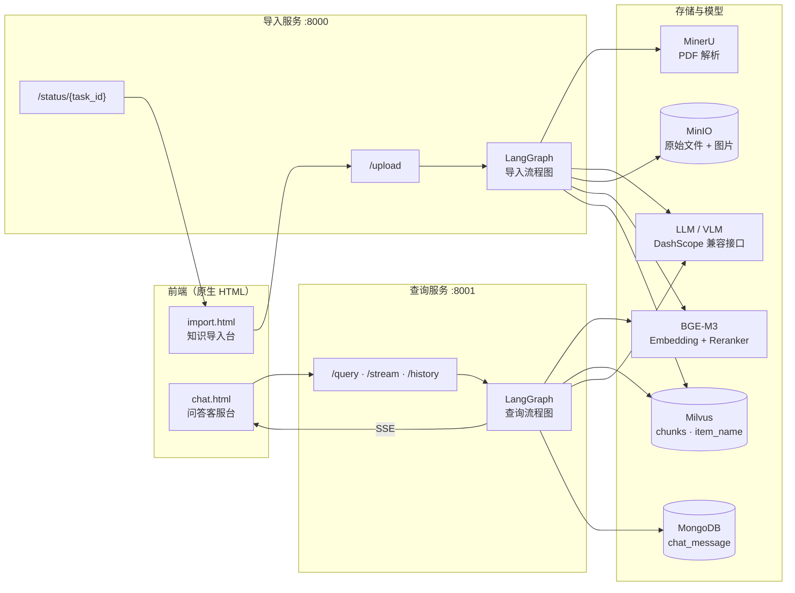
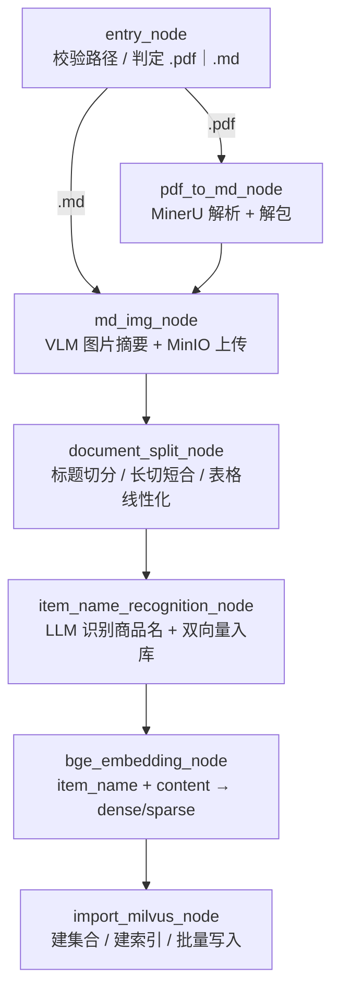
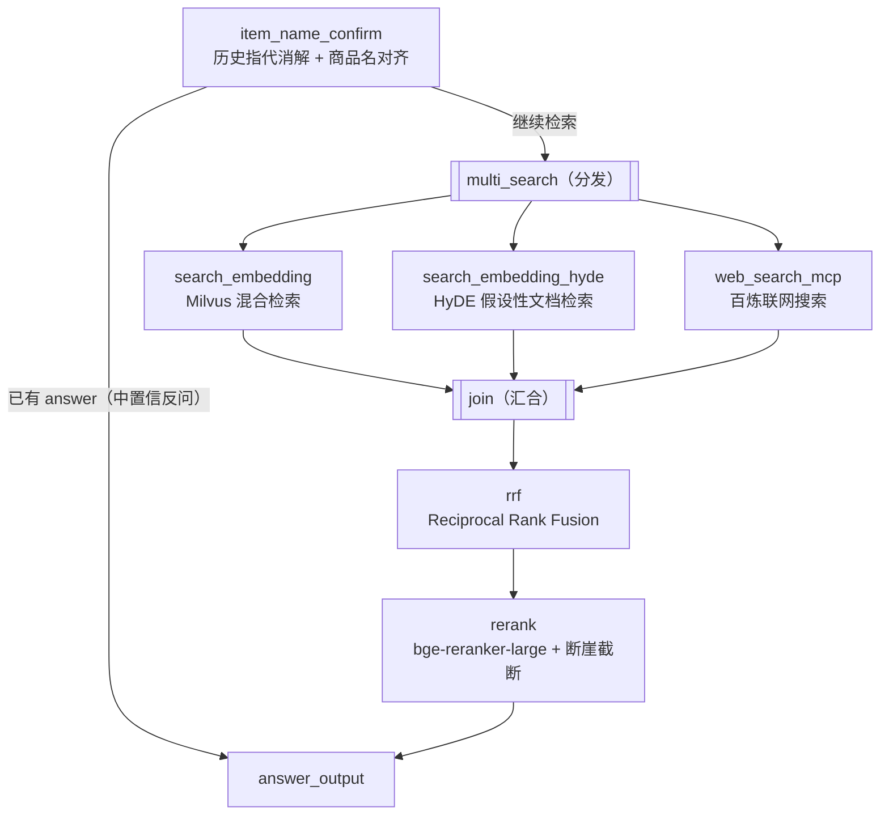

# 企业级设备手册智能问答平台

> 把厚重的 PDF / Markdown 设备手册变成可检索、可对话、能配图回答的知识库。
> 基于 **LangGraph + Milvus + BGE-M3 + MinerU + 大模型** 的端到端 RAG 工程实现。

<p align="left">
  
  
  
  
  
  
  
  
</p>

---

## 目录

- [项目简介](#项目简介)
- [核心能力](#核心能力)
- [系统架构](#系统架构)
- [导入流水线](#导入流水线)
- [查询流水线](#查询流水线)
- [技术栈](#技术栈)
- [目录结构](#目录结构)
- [快速开始](#快速开始)
- [接口文档](#接口文档)
- [数据模型](#数据模型)
- [关键配置项](#关键配置项)
- [已知限制与规划](#已知限制与规划)

---

## 项目简介

企业内部沉淀着大量设备手册：万用表、示波器、网关、交换机、工业控制器…… 它们通常是几十上百页的 PDF，图文混排、表格密集，关键词搜索找不到答案，翻页定位极其低效。

本项目把「手册」加工成「可对话的知识」：

1. **入库**：PDF 经 MinerU 解析为结构化 Markdown，图片被 VLM 语义化并托管到对象存储；
2. **切分**：按标题层级切分 + 长切短合 + 表格线性化，切片自带 `文件 / 父标题 / 标题 / 商品名` 四级上下文；
3. **检索**：BGE-M3 稠密 + 稀疏双向量混合检索，叠加 HyDE 假设性文档与联网搜索多路召回，RRF 融合后用 reranker 精排截断；
4. **回答**：大模型基于命中切片生成答案，支持 SSE 流式输出，并可直接回显手册原图（接线图、示意图、结构图）。

同时提供两条独立的 FastAPI 服务与两套零依赖原生页面：**知识导入台**（上传 + 节点级进度）与**问答客服台**（流式对话 + 历史会话）。

## 核心能力

| 能力 | 说明 |
| --- | --- |
| 手册结构化解析 | MinerU 4.x `parse -f zip --tier standard --ocr-mode auto`，保留 Markdown + images + 中间 JSON，表格与公式不丢 |
| 图片语义化 | 按「最近章节标题 + 上下 200 字正文」构造上下文，调用视觉大模型生成图片摘要，替换为 MinIO 公网链接，答案可直接带图 |
| 结构化切分 | 识别代码围栏内的 `#` 防止误切；标题层级维护 `hierarchy[]` 还原父标题；超长切片二次切分、过短切片合并 |
| 表格降维 | HTML / Markdown 表格统一线性化为「列名: 值」文本，避免表格被切断后语义丢失 |
| 商品主体识别 | LLM 从手册前若干切片抽取「品牌 + 型号 + 品类」写入 `item_name`，查询时作为标量过滤条件，避免跨设备串答案 |
| 混合检索 | 同一份文本同时产出 dense（COSINE）与 sparse（IP）向量，Milvus `WeightedRanker(0.5, 0.5)` 融合 |
| 多路召回 | 向量检索 ∥ HyDE 检索 ∥ 联网 MCP 搜索 三路并行，`join` 汇合后 RRF 去重 |
| 动态精排 | bge-reranker-large 打分，按分数断崖（gap ≥ 0.15）自适应截断 top-k（3~10），而非固定取前 N |
| 流式问答 | SSE 三类事件：`progress`（节点进度）/ `delta`（增量 token）/ `final`（完整答案） |
| 会话记忆 | MongoDB `chat_message` 持久化，查询前做指代消解（"它怎么测电阻" → "RS-12 数字万用表怎么测电阻"） |
| 任务可观测 | 每个导入任务 8 位 task_id，逐节点记录 running / done / 耗时，前端 1.5s 轮询渲染时间线 |

## 系统架构



## 导入流水线

`knowledge/processor/import_process/main_graph.py` —— 7 节点串行图，入口按后缀分流。



| # | 节点 | 职责 | 关键实现 |
| --- | --- | --- | --- |
| 1 | `entry_node` | 路径校验、按扩展名路由、提取 `file_title` | `ValidationError` 兜底，非 pdf/md 直接中断 |
| 2 | `pdf_to_md_node` | 调 `mineru-kit parse` 生成 zip，解包出 `markdown.md + images/` | `--tier standard`（小模型 + VLM）、`--ocr-mode auto`、行缓冲实时打印 |
| 3 | `md_img_node` | 扫描图片 → 定位章节上下文 → VLM 生成摘要 → 上传 MinIO → 回写链接 | 三段式：`ImageScanner` / `VLMSummarizer`（20 rpm 限流）/ `ImageUploader` |
| 4 | `document_split_node` | 标题切 initial section → 超长二次切 → 过短合并 → 组装 chunk | `hierarchy[7]` 还原父标题、代码围栏感知、`<table>` 线性化 |
| 5 | `item_name_recognition_node` | 取前 3 个切片（≤2500 字）让 LLM 输出商品名，写入 item_name 集合 | 结构化 Prompt + `UNKNOWN` 兜底 |
| 6 | `bge_embedding_node` | 以 `item_name + "\n" + content` 为嵌入文本，批量生成双向量 | batch=8，CSR → `{token_id: weight}` |
| 7 | `import_milvus_node` | 建集合（dynamic field）、建双索引、批量 insert 并回填 `chunk_id` | 门面 + 建造者模式：SchemaBuilder / IndexBuilder / Inserter |

导入阶段同时完成**文件双写**：本地 `knowledge/temp_data/{YYYYMMDD}/{task_id}/` 与 MinIO `origin_files/{YYYYMMDD}/{filename}`，便于溯源与重放。

## 查询流水线

`knowledge/processor/query_process/main_graph.py` —— 先确认主体，再并行三路召回，融合精排后生成答案。



| # | 节点 | 职责 | 关键参数 |
| --- | --- | --- | --- |
| 1 | `item_name_confirm` | 读最近会话 → LLM 抽取 `item_names` 与 `rewritten_query` → 向量对齐评分 → 高低置信决策 | 高置信 0.7 / 中置信 0.6 / 最多 5 个候选 |
| 2 | `search_embedding` | `item_names` 作为 `expr` 标量过滤，dense + sparse 混合检索 | `limit=10`，权重 0.5/0.5，`norm_score=True` |
| 3 | `search_embedding_hyde` | 先让 LLM 写一段"标准答案式"技术文档，再用它去检索 | `limit=5` |
| 4 | `web_search_mcp` | 通过 `MCPServerStreamableHttp` 调 `bailian_web_search`，补足手册外知识 | `count=3`，超时 300s |
| 5 | `rrf` | 三路结果按名次融合，chunk_id 去重 | `k=60`，`max_results=10` |
| 6 | `rerank` | 交叉编码器打分，按相邻分数断崖动态截断 | `top_k ∈ [3, 10]`，`gap_abs=0.15` |
| 7 | `answer_output` | 组装 `参考内容 + 历史对话 + 相关商品 + 问题`，流式或同步生成；解析 `【图片】` 区块 | 上下文预算 12000 字，历史 10 条 |

`answer_output` 会先按字符预算装配切片上下文（保留标题与图片链接），再补入历史对话；若命中切片里含图片，模型在答案末尾输出 `【图片】` 区块，前端解析后直接渲染原图。

## 技术栈

| 分层 | 选型 | 用途 |
| --- | --- | --- |
| Web 框架 | FastAPI + Uvicorn | 两条独立服务、SSE 流式响应、CORS、静态页面挂载 |
| 工作流编排 | LangGraph | 导入/查询状态图、条件边、并行分发与汇合 |
| 文档解析 | MinerU 4.x（`mineru-kit`） | PDF → Markdown + 图片 + 结构化 JSON |
| 向量模型 | BGE-M3 | 稠密 + 稀疏混合向量（1024 维）、中英双语 |
| 重排模型 | bge-reranker-large | 交叉编码器精排 |
| 向量库 | Milvus（MilvusClient） | HNSW/SPARSE 索引、hybrid_search、标量过滤 |
| 对象存储 | MinIO | 原始手册与图片托管，直链回显 |
| 会话存储 | MongoDB | `chat_message` 会话历史与商品名回填 |
| 大模型 | OpenAI 兼容接口（DashScope） | 商品名抽取、HyDE、答案生成、VLM 图片摘要 |
| 联网检索 | 阿里云百炼 MCP | `bailian_web_search` 工具 |
| 前端 | 原生 HTML + CSS + JS | 无构建依赖，`EventSource` 消费 SSE |

## 目录结构

```text
shoper_brain/
├── knowledge/
│   ├── api/
│   │   ├── import_router.py          # 导入服务入口（:8000）
│   │   └── query_router.py           # 查询服务入口（:8001）
│   ├── core/
│   │   ├── deps.py                   # Service 单例注入
│   │   └── paths.py                  # temp_data / front 路径常量
│   ├── front/
│   │   ├── import.html               # 知识导入台（拖拽上传 + 节点时间线）
│   │   └── chat.html                 # 问答客服台（流式对话 + 历史 + 配图）
│   ├── processor/
│   │   ├── import_process/
│   │   │   ├── main_graph.py         # 导入流程图
│   │   │   ├── state.py              # ImportGraphState
│   │   │   ├── config.py             # ImportConfig（环境变量）
│   │   │   ├── base.py               # BaseNode：日志/计时/异常包装
│   │   │   ├── exceptions.py         # 分层异常体系
│   │   │   └── nodes/                # entry / pdf_to_md / md_img / split / item_name / embedding / milvus
│   │   └── query_process/
│   │       ├── main_graph.py         # 查询流程图
│   │       ├── state.py              # QueryGraphState
│   │       ├── config.py             # QueryConfig（RRF/Rerank/召回参数）
│   │       ├── base.py               # BaseNode：含 SSE 进度推送
│   │       └── nodes/                # item_name_confirm / vector / hyde / web_mcp / rrf / rerank / answer
│   ├── prompt/                       # 导入与查询 Prompt 模板
│   ├── schema/                       # Pydantic 请求/响应模型
│   ├── service/                      # 业务层：上传双写、图调度、历史读写
│   ├── utils/
│   │   ├── client/                   # AI/存储客户端单例（双检锁 + 延迟初始化）
│   │   ├── embedding_util.py         # BGE-M3 hybrid 向量生成
│   │   ├── milvus_util.py            # 混合检索请求与执行
│   │   ├── markdown_util.py          # 表格线性化
│   │   ├── mongo_history_util.py     # 会话历史 CRUD
│   │   ├── sse_util.py               # SSE 队列与事件打包
│   │   └── task_util.py              # 任务进度、耗时、结果缓存
│   ├── test/                         # 连通性 / 解析 / 嵌入验证脚本
│   ├── .env                          # 本地密钥（.gitignore）
│   └── requirements.txt
├── tools/
│   └── pdf2md_zip.py                 # MinerU PDF→Markdown 独立工具（校验图片断链）
├── .env.example
└── README.md
```

## 快速开始

### 1. 环境要求

- Python **3.12**
- Milvus **2.4+**（standalone 即可）
- MinIO（或任意 S3 兼容存储）
- MongoDB **5.0+**
- 可访问的大模型服务（DashScope 兼容 OpenAI 协议）
- 本地 BGE-M3 与 bge-reranker-large 模型权重（CPU / CUDA 均可）

### 2. 拉取依赖服务（示例）

```bash
# Milvus standalone
docker run -d --name milvus -p 19530:19530 -p 9091:9091 milvusdb/milvus:latest

# MinIO
docker run -d --name minio -p 9000:9000 -p 9001:9001 \
  -e MINIO_ROOT_USER=minioadmin -e MINIO_ROOT_PASSWORD=minioadmin \
  minio/minio server /data --console-address ":9001"

# MongoDB
docker run -d --name mongo -p 27017:27017 mongo:7
```

### 3. 安装依赖

```bash
git clone https://github.com/<your-name>/<repo-name>.git
cd <repo-name>

python -m venv knowledge/.venv
# Windows
knowledge\.venv\Scripts\activate
# macOS / Linux
source knowledge/.venv/bin/activate

pip install -r knowledge/requirements.txt
```

MinerU 解析依赖 `mineru-kit` 可执行文件。若不在 `PATH` 中，请把 `knowledge/processor/import_process/nodes/pdf_to_md.py` 里的 `args[0]` 改成绝对路径（Windows 下为 `knowledge/.venv/Scripts/mineru-kit.exe`），或直接使用 `tools/pdf2md_zip.py`。

### 4. 配置环境变量

复制模板并填写：

```bash
cp .env.example knowledge/.env
```

`knowledge/.env` 至少需要以下几组：

```dotenv
# ---------- 大模型 ----------
OPENAI_API_BASE=https://dashscope.aliyuncs.com/compatible-mode/v1
DASHSCOPE_API_KEY=sk-xxxxxxxxxxxxxxxx
LLM_DEFAULT_MODEL=qwen-plus
VL_MODEL=qwen-vl-max
ITEM_MODEL=qwen-plus

# ---------- 向量 / 重排 ----------
BGE_M3_PATH=/models/bge-m3
BGE_RERANKER_LARGE=/models/bge-reranker-large
BGE_DEVICE=cuda:0
BGE_FP16=true
EMBEDDING_DIM=1024

# ---------- Milvus ----------
MILVUS_URL=http://127.0.0.1:19530
CHUNKS_COLLECTION=kb_chunks
ITEM_NAME_COLLECTION=kb_item_name

# ---------- MinIO ----------
MINIO_ENDPOINT=127.0.0.1:9000
MINIO_ACCESS_KEY=minioadmin
MINIO_SECRET_KEY=minioadmin
MINIO_BUCKET_NAME=knowledge-base-files

# ---------- MongoDB ----------
MONGO_URL=mongodb://127.0.0.1:27017
MONGO_DB_NAME=knowledge

# ---------- MCP 联网搜索 ----------
MCP_DASHSCOPE_BASE_URL=https://dashscope.aliyuncs.com/api/v1/mcps/web-search/mcp
```

### 5. 启动服务

在项目根目录（`shoper_brain/`）执行，`-m` 方式保证 `knowledge` 包可被导入：

```bash
# 终端 1：导入服务（上传 / 解析 / 入库）
python -m knowledge.api.import_router     # http://127.0.0.1:8000

# 终端 2：查询服务（问答 / 流式 / 历史）
python -m knowledge.api.query_router      # http://127.0.0.1:8001
```

### 6. 使用

| 页面 | 地址 | 用途 |
| --- | --- | --- |
| 知识导入台 | <http://127.0.0.1:8000/import> | 拖拽上传 PDF/Markdown，实时查看 7 个节点进度与耗时 |
| 问答客服台 | <http://127.0.0.1:8001/chat> | 连续对话、勾选流式输出、清空会话、查看配图 |

## 接口文档

启动后可直接访问 `/docs`（FastAPI 自带 Swagger）。

### 导入服务 `:8000`

| 方法 | 路径 | 说明 | 主要参数 |
| --- | --- | --- | --- |
| GET | `/import` | 返回导入页面 | — |
| POST | `/upload` | 上传手册并异步入库 | `multipart/form-data: file` |
| GET | `/status/{task_id}` | 查询任务进度 | 返回 `status` / `done_list` / `running_list` / `durations` |

```bash
# 上传
curl -X POST http://127.0.0.1:8000/upload \
  -F "file=@./万用表RS-12的使用.pdf"

# => {"task_id":"9a5b6f81","message":"文件上传成功,请等待导入流程完成"}

# 轮询进度
curl http://127.0.0.1:8000/status/9a5b6f81
```

### 查询服务 `:8001`

| 方法 | 路径 | 说明 | 主要参数 |
| --- | --- | --- | --- |
| GET | `/chat` | 返回问答页面 | — |
| POST | `/query` | 提交问题（流式 / 非流式） | `query`、`session_id`、`is_stream` |
| GET | `/stream/{task_id}` | SSE 事件流 | `event: progress｜delta｜final` |
| GET | `/history/{session_id}` | 拉取历史会话 | `limit` 默认 50 |
| DELETE | `/history/{session_id}` | 清空会话 | 返回 `deleted_count` |

```bash
# 非流式
curl -X POST http://127.0.0.1:8001/query \
  -H "Content-Type: application/json" \
  -d '{"query":"RS-12 万用表怎么测直流电压？","session_id":"sess-demo","is_stream":false}'

# => {"message":"查询成功","session_id":"sess-demo","answer":"...","task_id":"..."}

# 流式：先提交拿 task_id，再订阅 SSE
curl -X POST http://127.0.0.1:8001/query \
  -H "Content-Type: application/json" \
  -d '{"query":"它怎么测电阻？","session_id":"sess-demo","is_stream":true}'

curl -N http://127.0.0.1:8001/stream/<task_id>
```

SSE 事件格式：

```text
event: progress
data: {"status": "processing", "done_list": ["welcome"], "running_list": ["search_embedding"]}

event: delta
data: {"delta": "将功能转盘置于"}

event: final
data: {"answer": "……完整答案……"}
```

## 数据模型

### Milvus：切片集合（`CHUNKS_COLLECTION`）

| 字段 | 类型 | 说明 |
| --- | --- | --- |
| `chunk_id` | INT64（主键，auto_id） | 切片唯一 ID，插入后回填 |
| `dense_vector` | FLOAT_VECTOR(dim=1024) | BGE-M3 稠密向量，索引 `AUTOINDEX` / `COSINE` |
| `sparse_vector` | SPARSE_FLOAT_VECTOR | BGE-M3 稀疏向量，索引 `SPARSE_INVERTED_INDEX` / `IP` |
| `content` | VARCHAR(65535) | 切片正文（含 Markdown 图片链接） |
| `title` | VARCHAR(65535) | 当前章节标题 |
| `parent_title` | VARCHAR(65535) | 上级章节标题 |
| `file_title` | VARCHAR(65535) | 所属手册文件名 |
| `item_name` | VARCHAR(65535) | 商品/设备名称，检索时作为过滤条件 |

### Milvus：商品名集合（`ITEM_NAME_COLLECTION`）

存放 `item_name` 的稠密 + 稀疏向量，用于查询时的实体对齐与候选打分。

### MongoDB：`chat_message`

| 字段 | 类型 | 说明 |
| --- | --- | --- |
| `session_id` | string | 会话 ID |
| `role` | string | `user` / `assistant` |
| `text` | string | 消息正文 |
| `rewritten_query` | string | 指代消解后的问题 |
| `item_names` | array | 该消息关联的商品名 |
| `ts` | float | 时间戳 |

## 关键配置项

导入侧（`knowledge/processor/import_process/config.py`）：

| 变量 / 属性 | 默认值 | 说明 |
| --- | --- | --- |
| `max_content_length` | 1000 | 切片最大长度，超出则二次切分 |
| `min_content_length` | 500 | 切片最小长度，不足则与相邻切片合并 |
| `img_content_length` | 200 | 图片上下文抓取字数 |
| `item_name_chunk_k` | 3 | 商品名识别使用的切片数 |
| `embedding_batch_size` | 8 | 批量嵌入大小 |
| `requests_per_minute` | 20 | VLM 图片摘要速率限制 |

查询侧（`knowledge/processor/query_process/config.py`）：

| 环境变量 | 默认值 | 说明 |
| --- | --- | --- |
| `MAX_CONTEXT_CHARS` | 12000 | 拼装给 LLM 的上下文预算 |
| `RRF_K` | 60 | RRF 平滑常数 |
| `RRF_MAX_RESULTS` | 10 | 融合后保留数量 |
| `RERANK_MAX_TOP_K` / `RERANK_MIN_TOP_K` | 10 / 3 | 断崖截断上下界 |
| `RERANK_GAP_ABS` | 0.15 | 相邻分数断崖阈值 |
| `EMBEDDING_SEARCH_LIMIT` | 10 | 向量检索召回数 |
| `HYDE_SEARCH_LIMIT` | 5 | HyDE 检索召回数 |
| `ITEM_NAME_HIGH_CONFIDENCE` / `MID_CONFIDENCE` | 0.7 / 0.6 | 商品名确认置信度阈值 |

## 已知限制与规划

- **商品名对齐仍在完善**：`ItemNameAligner` 已预留向量对齐与分数差过滤的骨架，中置信场景的候选反问逻辑尚未全量接入。
- **任务状态为进程内存**：`task_util` 使用内存字典维护进度与结果，服务重启后任务状态丢失；后续将迁移至 Redis。
- **查询侧进度轮询**：`/status/{task_id}` 目前仅由导入服务提供，`chat.html` 已预留轮询入口，接入后可在对话页展示检索阶段进度。
- **无鉴权 / 多租户**：当前面向内网或本地部署，生产环境建议前置网关做鉴权、限流与文件类型校验。
- **规划**：BM25 独立召回通道、切片去重与增量更新、答案引用溯源（页码级）、多模态检索（以图搜手册）、Docker Compose 一键编排。

---

如果这个项目对你有帮助，欢迎 Star ⭐ 与 Issue 交流。